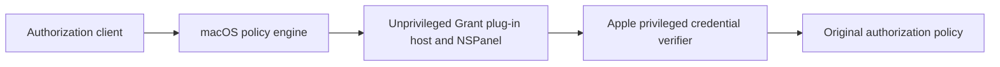
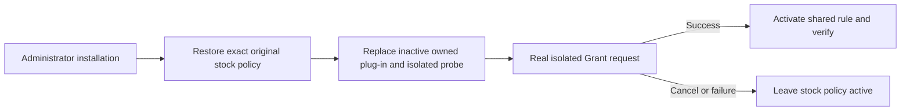

# Grant integration — candidate 0.2.3

Grant is a local macOS candidate for the shared administrator authorization
rule. Its Authorization Plug-in uses Apple's public plug-in interface in an
unprivileged host and presents its own compact `NSPanel`. It does not embed an
`SFAuthorizationPluginView` or replace a view inside Apple's outer dialog. The compact 0.2.2 host was confirmed by the user. New Original/sudo paths require separate live acceptance; build output does not establish it.

## Mechanism boundary

The plug-in receives the public username context value when supplied. The
console account is only an editable convenience prefill. The caller-supplied
prompt hint may be absent; in that case Grant displays a generic administrator
access title and does not invent an operation such as power-settings access.
The compact credential view is 440 × 184pt, focuses the password field, submits
on Return and cancels on Escape. Changing the account expands the panel by 36pt
when needed. Passwords are sent to Apple's privileged verifier as
nonextractable credentials. Grant does not verify passwords, grant root
privileges, execute privileged operations, or store/log credentials. The preview
disables credential entry.

## Corner settings

Preview and real authorization share the bottom-right native settings menu.
The plugin opens the fixed installed app belonging to the Preferences directory
owner. Cosmetic `grant://appearance/<key>/<value>?request=<UUID>` routes accept
only style, appearance, typography and language enums. The owner app merges the
latest settings, writes atomically and verifies readback. Notifications only
trigger a bounded read of the fixed preferences file; their contents cannot
become settings or paths. A ten-second one-shot response limit reports failure.
The background app has a twelve-second idle exit canceled by another request;
no daemon is installed. Credentials never enter this bridge.

Live appearance changes retain native fields, account form, focus, authentication
errors and interaction state. Stopped, submitted, destroyed or stale generations
cannot act on old menu intents/callbacks. Full settings and Fonts explicitly end
the request: start the owner app without activation, then cancel and activate on
successful opening. Launch failure leaves authorization usable. Policy changes
remain in the app's receipt-guarded setup/restore flow. Setup Original is a live shared style in 0.2.3. Its immutable standalone reference remains preview-only.

## Installation, activation and recovery

1. `grant install-app` installs the signed app into `~/Applications/Grant.app`
   and the managed command into `~/.local/bin/grant`. Earlier owned app files
   are preserved under `Local/DesktopBackups`.
2. `grant settings` opens the app. Theme changes validate in the native renderer
   and save/read back cosmetic preferences. Before system setup, preferences
   are user-local; afterwards the app and CLI share the appearance file under
   `/Library/Application Support/Grant/`.
3. `grant install-system [plan.json]`, also available in Settings, prepares a
   plan and requests administrator authority through sudo. The human enters the
   password in Terminal.
4. The installer checks its receipt, policy, manifest, owner and plan guards,
   then restores the exact original stock policy. It replaces the inactive
   Grant plug-in and isolated probe and verifies them before activation. A plan
   may resume after a prior stock-policy restore.
5. The original regular user runs `grant probe` to request the isolated test
   right. This request exercises the new panel host. Cancellation or failure
   leaves the stock policy active. Only a successful probe allows activation of
   the shared administrator rule. The previous Grant rule is not claimed to be
   restored after a failed or cancelled probe.
6. Activation preserves Apple's privileged credential verifier and the
   administrator-group policy, then reads back the resulting rules and records
   a root-owned receipt. Use `grant status` and the latest receipt to inspect
   current state.
7. `grant restore-system <id>` restores only the exact owned policy and refuses
   drift. Independent recovery without the project runtime is documented in the
   receipt's `before.plist` using `security authorizationdb write`.

The generated setup command and short CLI refer to this local project and the
existing Deno executable. No privileged daemon or login item is added. Root-owned
receipt and client folders are protected from the regular user. Never put a
password in a plan, fixture, log or chat.

## Coverage and historical evidence

`grant request` asks macOS to evaluate `system.privilege.admin` and performs no
privileged operation; it can be cancelled. `grant probe` requests the isolated
probe right, while `grant preview` is a disabled-input fixture. The 0.2.3
standalone panel host has not yet completed live acceptance. Historical 0.1.1
embedded-view fixtures and any 394-point host-size notes describe the previous
implementation and are not claims about this panel.

A shared authorization rule does not cover every password prompt. Participating
apps, wrong-password/retry behavior and Touch ID must be tested separately.
Terminal sudo uses the opt-in askpass route above. Login, FileVault, Keychain and LocalAuthentication screens are
separate paths unless directly proved. The panel does not promise native Touch
ID or password-reset affordances. Appearance settings affect presentation only;
Apple's credential verifier and policy remain authoritative.

## Sources

- [Authorization Services](https://developer.apple.com/documentation/security/authorization-services)
- [Extending authorization services with plug-ins](https://developer.apple.com/documentation/security/extending-authorization-services-with-plug-ins)

Historical design and host observations are retained only as dated fixtures;
they do not describe the current standalone panel architecture.

## Terminal sudo and Setup Original

`Setup Original` is a sixth selectable live style, using the original Setup
header, seven-row table, native secure field and Continue/Cancel buttons. It is
560 × 460pt (plus 36pt when the system account field is expanded); the other five
styles keep their compact geometry. The immutable reference remains available.
Live rows use the actual authentication context rather than fabricated Setup
operation metadata. Selecting Original requires a system plugin at least 0.2.3
when Grant is globally active, so an older reader cannot receive an unsupported style.

The Settings toggle **Use Grant for local terminal sudo** is persisted as
`terminalSudo` (default true). Setup's zsh startup sources the installed app's
`grant_shell.zsh`. Reload existing tabs with `source ~/.zshrc`, or open a new tab.
The function adds sudo's supported `-A`/`SUDO_ASKPASS` route only for local,
interactive, input/output-terminal calls. Explicit `-A`, `-S`, `-n`, an existing
`SUDO_ASKPASS`, unknown flags, SSH, tmux/screen and scripts retain their native
route; `command sudo` and `/usr/bin/sudo` bypass the function. The invoking user's
active console session must match. Sudo still owns validation, retries, command
execution and timestamp caching. A cached/NOPASSWD request needs no password
window; this route does not force a new challenge on every command.

`grant request-sudo` deliberately ignores cached credentials for one harmless
`/usr/bin/true` request so the real UI can be checked. No password is sent through
the CLI or saved: the helper sends one newline-terminated response directly to
its actual sudo parent's pipe. Cancellation sends zero bytes. The transport
supports 1–255 UTF-8 bytes without NUL/CR/LF; only its mutable buffer is explicitly
wiped, not all AppKit/runtime copies. Use the native route for unsupported input.
The helper checks its nonroot identity, active console, direct sudo parent/start
time and pipe again before releasing a response; parent/session loss cancels it.

This is an opt-in terminal bridge, separate from Authorization Services. It adds
no PAM/sudoers modification or daemon. Login, FileVault, Keychain and
LocalAuthentication prompts remain separate. Live iTerm2 acceptance, system
plugin version and installation state must be read from the work record and
`grant status`; renderer fixtures are not evidence of an authenticated command.
