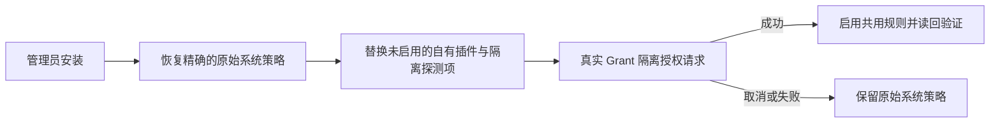

# Grant 接入与恢复 · 0.2.3 候选

Grant 是 macOS 共用管理员授权规则的本机候选。授权插件通过 Apple 公开插件接口运行于非特权进程，并自行显示紧凑的 `NSPanel`。它不会把 `SFAuthorizationPluginView` 嵌入 Apple 外层窗口。新面板宿主仍待实机验收；构建结果与历史夹具不能证明该项通过。

## 机制边界

插件会读取公开的用户名上下文（若调用方提供）。控制台账户只作为可编辑的便捷预填。调用方提供的提示文字也可能缺失；此时显示通用管理员访问标题，不编造电源设置等操作。凭证视图为 440 × 184pt，密码框取得焦点，Return 提交、Escape 取消。需要更改账户时，面板会按需增高 36pt。密码以不可提取凭证交给 Apple 特权验证器。Grant 不验证密码、不授予 root 权限、不执行特权操作，也不保存或记录凭证。预览禁用凭证输入。

## 角落设置

预览与真实授权共用右下角原生菜单。插件按 Preferences 目录所有者定位固定
安装 App；`grant://appearance/<key>/<value>?request=<UUID>` 仅接受主题、
外观、字体模式及语言枚举。用户 App 合并最新设置，原子写入并读回。通知只
触发读取固定偏好文件，不能提供可信的值或路径。十秒单次响应上限会报告
失败。后台 App 在空闲十二秒后退出，后续请求取消退出；不安装常驻服务。
凭证不会进入这条设置通道。

即时外观更新保留原生字段、账户展开状态、焦点、认证错误及交互状态。停止、
提交、销毁或旧阶段不能执行旧菜单意图或回调。字体及完整设置明确结束本次
请求：先不激活地启动用户 App，成功打开后取消请求并激活 App；失败则保留
可用授权窗口。系统策略仍走 App 里基于收据检查的接入／恢复流程。此处的
Setup 原版已是共用实际样式；不可变的独立参考窗口仍仅供预览。

## 安装、启用与恢复

1. `grant install-app` 将签名 App 安装到 `~/Applications/Grant.app`，并将管理命令安装到 `~/.local/bin/grant`。旧有自有 App 文件保留在 `Local/DesktopBackups`。
2. `grant settings` 打开设置。主题变更由原生渲染器校验，并保存后读回。接入系统前，外观设定保存在用户目录；接入后，App 与 CLI 共用 `/Library/Application Support/Grant/` 下的外观文件。
3. 设置中的接入按钮或 `grant install-system [plan.json]` 准备计划，并通过 sudo 请求管理员授权；密码由使用者在 Terminal 输入。
4. 安装器核对收据、策略、清单、拥有者与计划保护条件，然后恢复精确的原始系统策略。它替换未启用的 Grant 插件与隔离探测项，并在启用前验证。先前已恢复系统策略的计划可继续执行。
5. 原始普通用户运行 `grant probe` 请求隔离测试规则，以验证新面板宿主。取消或失败时系统原始策略保持启用。只有探测成功后才能启用共用管理员规则。失败或取消后不会声称已恢复先前的 Grant 规则。
6. 启用时保留 Apple 特权凭证验证器与管理员组策略，读回核对规则并写入 root 所有的收据。用 `grant status` 与最新收据查看现况。
7. `grant restore-system <id>` 仅恢复完全匹配的自有策略；若检测到漂移便拒绝覆盖。脱离项目运行环境的恢复方式记录于收据中的 `before.plist`，可用 `security authorizationdb write` 执行。

生成的安装入口与短命令依赖本机项目及现有 Deno，不新增特权守护进程或登录启动项。普通用户不能修改 root 所有的收据与客户端目录。切勿将密码写入计划、夹具、日志或聊天。

## 覆盖范围与历史证据

`grant request` 请求 macOS 评估 `system.privilege.admin`，不执行特权操作，可取消。`grant probe` 请求隔离测试规则；`grant preview` 是禁用输入的演示夹具。用户已确认 0.2.2 紧凑面板；0.2.3 新增路径须单独验收。历史 0.1.1 内嵌视图夹具及 394 点宿主尺寸记录只描述旧实现，不代表当前面板。

共用授权规则不涵盖所有密码提示。参与 App、错误密码／重试行为与 Touch ID 必须分别验收。终端 sudo 使用上文明确接入。登录、FileVault、Keychain 和 LocalAuthentication 界面是不同路径，除非直接证明，否则不应声称覆盖。面板不承诺提供原生 Touch ID 或密码重置入口。外观设置只影响呈现；Apple 的凭证验证器与授权策略仍具决定权。

## 来源

- [Authorization Services](https://developer.apple.com/documentation/security/authorization-services)
- [通过插件扩展授权服务](https://developer.apple.com/documentation/security/extending-authorization-services-with-plug-ins)

历史设计与宿主观察仅作为有日期的夹具保留，不描述当前独立面板架构。

## 终端 sudo 与 Setup 原版

`Setup 原版` 是第六套可选的实际授权样式，保留旧 Setup 的页头、七行表格、原生密码框与继续／取消按钮。尺寸为 560 × 460pt；系统账户框展开时增加 36pt。另外五套仍保持紧凑尺寸。原始参考实现继续保留。实际授权展示真实认证上下文，不编造 Setup 操作信息。Grant 全局启用时，系统插件须先更新至至少 0.2.3 才能选择原版，避免旧插件收到不支持的样式。

设置中的「终端 sudo 使用 Grant」保存为 `terminalSudo`，默认 true。Setup 的 zsh 启动配置加载已安装 App 内的 `grant_shell.zsh`。已有标签页运行 `source ~/.zshrc`，或新开标签页。本机交互式 zsh 且输入／输出均连接终端时，函数才添加 sudo 官方 `-A`／`SUDO_ASKPASS` 接口。明确指定 `-A`、`-S`、`-n`，已有 `SUDO_ASKPASS`、未知选项、SSH、tmux/screen、脚本保持原认证方式；`command sudo` 与 `/usr/bin/sudo` 直接绕过函数。调用账户必须是当前本机控制台用户。验证、重试、命令执行和密码缓存仍由 sudo 控制；缓存有效或 NOPASSWD 时不会弹密码框。

`grant request-sudo` 为一次无害的 `/usr/bin/true` 请求忽略已有缓存，专门检查真实窗口。助手将一条密码响应直接交给真正 sudo 父进程的管道，取消输出零字节，CLI 不接收或保存密码。支持 1–255 个 UTF-8 字节，不含 NUL／回车／换行；仅显式擦除自己的可变传输缓冲区，不承诺擦除 AppKit 的所有内部副本。不支持的输入请使用原认证方式。助手在提交前复查普通用户身份、控制台用户、sudo 父进程路径／启动时间与输出管道；父进程退出或用户会话变化时取消。

这是可关闭的终端接入，不修改 PAM／sudoers，也不新增常驻服务。登录、FileVault、Keychain 和 LocalAuthentication 仍是独立路径。实际 iTerm2 验收、系统插件版本与安装状态见工作记录及 `grant status`；渲染夹具不能证明密码认证或命令执行成功。
