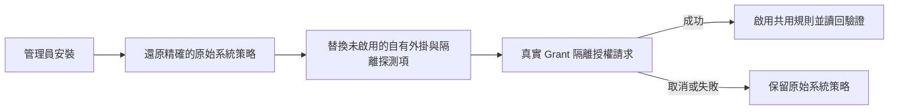

# Grant 接入與復原 · 0.2.3 候選

Grant 是 macOS 共用管理員授權規則的本機候選。授權外掛透過 Apple 公開外掛介面執行於非特權程序，並自行顯示精簡的 `NSPanel`。它不會把 `SFAuthorizationPluginView` 嵌入 Apple 外層視窗。新面板宿主仍待實機驗收；建置結果與歷史夾具無法證明該項通過。

## 機制邊界

外掛會讀取公開的使用者名稱上下文（若呼叫端提供）。主控台帳號只作為可編輯的便利預填。呼叫端提供的提示文字也可能缺少；此時顯示通用管理員存取標題，不編造電源設定等操作。憑證檢視為 440 × 184pt，密碼欄位取得焦點，Return 送出、Escape 取消。需要更改帳號時，面板會視需要增高 36pt。密碼以不可擷取憑證交給 Apple 特權驗證器。Grant 不驗證密碼、不授予 root 權限、不執行特權操作，也不儲存或記錄憑證。預覽停用憑證輸入。

## 角落設定

預覽與實際授權共用右下角原生選單。外掛依 Preferences 目錄擁有者定位固定
安裝 App；`grant://appearance/<key>/<value>?request=<UUID>` 僅接受主題、
外觀、字體模式及語言列舉。使用者 App 合併最新設定，原子寫入並讀回。通知
只觸發讀取固定偏好檔，不能提供可信的值或路徑。十秒單次回應上限會回報
失敗。背景 App 在閒置十二秒後退出，後續請求取消退出；不安裝常駐服務。
憑證不會進入這條設定通道。

即時外觀更新保留原生欄位、帳號展開狀態、焦點、認證錯誤及互動狀態。停止、
送出、銷毀或舊階段不能執行舊選單意圖或回呼。字體及完整設定明確結束本次
請求：先不啟動為前景地開啟使用者 App，成功開啟後取消請求並啟動 App；失敗
則保留可用授權視窗。系統策略仍走 App 裡依收據檢查的接入／復原流程。此處
的Setup 原版已是共用實際樣式；不可變的獨立參考視窗仍僅供預覽。

## 安裝、啟用與復原

1. `grant install-app` 將簽署 App 安裝至 `~/Applications/Grant.app`，並將管理命令安裝至 `~/.local/bin/grant`。舊有自有 App 檔案保留於 `Local/DesktopBackups`。
2. `grant settings` 開啟設定。主題變更由原生繪製器驗證，並於儲存後讀回。接入系統前，外觀設定儲存於使用者目錄；接入後，App 與 CLI 共用 `/Library/Application Support/Grant/` 下的外觀檔案。
3. 設定中的接入按鈕或 `grant install-system [plan.json]` 準備計畫，並透過 sudo 請求管理員授權；密碼由使用者在 Terminal 輸入。
4. 安裝器核對收據、策略、清單、擁有者與計畫防護條件，然後還原精確的原始系統策略。它替換未啟用的 Grant 外掛與隔離探測項，並在啟用前驗證。先前已還原系統策略的計畫可以接續執行。
5. 原始一般使用者執行 `grant probe` 請求隔離測試規則，以驗證新面板宿主。取消或失敗時，系統原始策略維持啟用。只有探測成功後才能啟用共用管理員規則。失敗或取消後不會宣稱已還原先前的 Grant 規則。
6. 啟用時保留 Apple 特權憑證驗證器與管理員群組策略，讀回核對規則並寫入 root 擁有的收據。使用 `grant status` 與最新收據檢視現況。
7. `grant restore-system <id>` 僅還原完全相符的自有策略；若偵測到漂移便拒絕覆寫。脫離專案執行環境的復原方式記錄於收據中的 `before.plist`，可使用 `security authorizationdb write` 執行。

產生的安裝入口與短命令依賴本機專案及既有 Deno，不新增特權常駐服務或登入啟動項。一般使用者無法修改 root 擁有的收據與用戶端目錄。切勿將密碼寫入計畫、夾具、記錄或聊天。

## 覆蓋範圍與歷史證據

`grant request` 請求 macOS 評估 `system.privilege.admin`，不執行特權操作，可以取消。`grant probe` 請求隔離測試規則；`grant preview` 是停用輸入的展示夾具。使用者已確認 0.2.2 緊湊面板；0.2.3 新增路徑須單獨驗收。歷史 0.1.1 內嵌檢視夾具及 394 點宿主尺寸紀錄只描述舊實作，不代表目前面板。

共用授權規則不涵蓋所有密碼提示。參與 App、錯誤密碼／重試行為與 Touch ID 必須分別驗收。終端機 sudo 使用上文明確接入。登入、FileVault、Keychain 和 LocalAuthentication 介面是不同路徑，除非直接證明，否則不應宣稱涵蓋。面板不承諾提供原生 Touch ID 或密碼重設入口。外觀設定只影響呈現；Apple 的憑證驗證器與授權策略仍具決定權。

## 來源

- [Authorization Services](https://developer.apple.com/documentation/security/authorization-services)
- [透過外掛擴充授權服務](https://developer.apple.com/documentation/security/extending-authorization-services-with-plug-ins)

歷史設計與宿主觀察僅作為有日期的夾具保留，不描述目前獨立面板架構。

## 終端機 sudo 與 Setup 原版

`Setup 原版` 是第六套可選的實際授權樣式，保留舊 Setup 的頁首、七列表格、原生密碼框及繼續／取消按鈕。尺寸為 560 × 460pt；系統帳號框展開時增加 36pt。另外五套仍維持緊湊尺寸。原始參考實作繼續保留。實際授權顯示真實驗證情境，不編造 Setup 操作資訊。Grant 全域啟用時，系統外掛須先更新至至少 0.2.3 才能選擇原版，避免舊外掛收到不支援的樣式。

設定中的「終端機 sudo 使用 Grant」儲存為 `terminalSudo`，預設 true。Setup 的 zsh 啟動設定載入已安裝 App 內的 `grant_shell.zsh`。既有分頁執行 `source ~/.zshrc`，或開啟新分頁。本機互動式 zsh 且輸入／輸出均連接終端機時，函式才加入 sudo 官方 `-A`／`SUDO_ASKPASS` 介面。明確指定 `-A`、`-S`、`-n`，既有 `SUDO_ASKPASS`、未知選項、SSH、tmux/screen、腳本維持原驗證方式；`command sudo` 與 `/usr/bin/sudo` 直接繞過函式。呼叫帳號必須是目前本機控制台使用者。驗證、重試、命令執行及密碼快取仍由 sudo 控制；快取有效或 NOPASSWD 時不會彈出密碼框。

`grant request-sudo` 為一次無害的 `/usr/bin/true` 請求忽略既有快取，專門檢查真實視窗。助手將一條密碼回應直接交給真正 sudo 父行程的管道，取消輸出零位元組，CLI 不接收或儲存密碼。支援 1–255 個 UTF-8 位元組，不含 NUL／歸位／換行；僅明確擦除自己的可變傳輸緩衝區，不承諾擦除 AppKit 的所有內部副本。不支援的輸入請使用原驗證方式。助手在送出前複查一般使用者身分、控制台使用者、sudo 父行程路徑／啟動時間及輸出管道；父行程退出或使用者工作階段變動時取消。

這是可關閉的終端機接入，不修改 PAM／sudoers，也不新增常駐服務。登入、FileVault、Keychain 及 LocalAuthentication 仍是獨立路徑。實際 iTerm2 驗收、系統外掛版本及安裝狀態見工作記錄與 `grant status`；算繪測試圖不能證明密碼驗證或命令執行成功。
