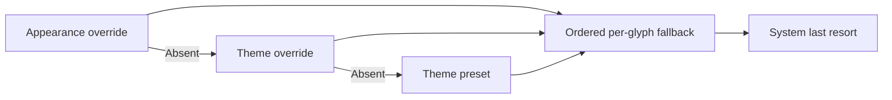

# Theme typography



Open Settings with the preview’s sliders button or Cmd+, then choose Fonts. Each
theme has a distinct display stack. The Fonts panel has Both appearances, Light
and Dark scopes, exposes exact names, availability and actual Core Text
providers, and saves only on Apply. Reset removes the chosen scope's override: a
Light/Dark reset inherits the theme stack; a Both reset restores the preset
without deleting independent Light/Dark overrides. System mode bypasses custom
stacks temporarily; overrides are retained. Controls use system sans; technical
context uses system mono. No font is downloaded or installed.

| Theme          | Preferred face            | Ordered fallbacks                                         |
| -------------- | ------------------------- | --------------------------------------------------------- |
| Paper Punch    | `Impact`                  | `AvenirNextCondensed-Heavy`, `@system-condensed`          |
| Dot Instrument | `DotoMod800ZhRefined`     | `Doto`, `DeparturePixelZhCompact-Regular`, `@system-mono` |
| Swiss Signal   | `HelveticaNeue-Bold`      | `@system`                                                 |
| Hard Edge      | `BlackOpsOne-Regular`     | `Impact`, `@system-condensed`                             |
| Blueprint      | `SairaStencilOne-Regular` | `DeparturePixelZhCompact-Regular`, `@system-condensed`    |

Impact, Avenir and Helvetica use the Mac's existing system installation and are
not redistributed. Personal Doto Refined faces are optional `X-FontMod`
products, not included in Grant. Higher is the named HGHT=128 instance of the
85%-width Tall Condensed family, with weight700 baked into regular metadata; it
can be selected in a custom stack. No synthesized bold or extra font transform
is used. Bundled `Doto` selects the source file at wght=800, ROND=0; bundled
Compact loads the verified source-derived file directly. Full asset hashes,
source and license records are in Resources/Licenses/fonts.json. AI lettering is
not font proof.

Missing names advance through the stack; missing glyphs advance for each
composed character. Dot uses Refined Chinese when available, then bundled
Compact. Blueprint uses bundled Compact for CJK. Paper/Swiss/Hard Edge retain
the platform CJK cascade. Every stack has system last resort, including CJK,
symbols and emoji. A completely missing configured stack remains readable.
Allowed tokens are @system, @system-condensed and @system-mono.

Black Ops One and Saira Stencil One load directly from the bundled TTF files.
Their pinned Google Fonts sources, SHA-256 values and original OFL notices are
recorded in the same font manifest. Blueprint fits and centers actual glyph ink,
so Saira’s large line box does not shrink the compact title. No glyph outline,
font file or font width is modified.

## Settings

Both override objects are optional schema1 extensions. Each supplied stack has
1–12 nonempty exact PostScript names (maximum128 characters each). Paths,
control characters, unknown @ tokens and invalid scope names are rejected.
Missing font names are valid and disclosed. Font resolution uses the actual
current light/dark appearance, including System appearance changes. Example with
optional local faces:

```json
{
  "schemaVersion": 1,
  "style": "dot",
  "appearance": "system",
  "typography": "theme",
  "language": "en",
  "fontOverrides": {
    "dot": [
      "DotoMod800ZhRefined",
      "Doto",
      "DeparturePixelZhCompact-Regular",
      "@system-mono"
    ]
  },
  "appearanceFontOverrides": {
    "dot": {
      "light": [
        "DotoMod800ZhRefined",
        "Doto",
        "DeparturePixelZhCompact-Regular"
      ],
      "dark": [
        "DotoMod700ZhRefinedTallCondensed-Higher",
        "Doto",
        "DeparturePixelZhCompact-Regular"
      ]
    }
  }
}
```

Preview JSON is written atomically and decoded/read back. Older settings are
backed up byte-for-byte as settings.before-selected-themes.json before
migration. Legacy module maps to dot, nothing to paper, and typography dots to
theme; existing font overrides are retained. Invalid input preserves saved
preferences. The same settings shape works in the plugin. The installed App and
CLI share cosmetic preferences; the isolated development preview uses its own
state directory. Changing fonts never activates a plugin or changes policy.
SecurityAgent may see a different installed-font set; actual host loading needs
the real isolated probe.

`./grant render` checks native single-line titles/context, missing-font
fallback, system last resort, independent light/dark providers, inherited stacks
and invalid scope rejection. Native font metrics and screenshots are inspected
together.
