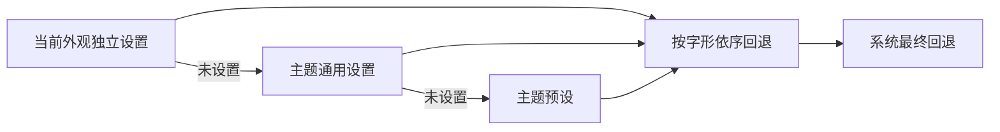

# 主题字体



用预览底部滑杆按钮或 Cmd+, 打开「设置」，再进入「字体」。
「字体」面板可选择主题通用、浅色、深色，列出完整名称、可用状态与实际 Core Text
字形来源，按「应用」才保存。重置浅色／深色恢复继承主题设置；重置通用设置恢复
预设，但保留独立浅深色设置。System 模式临时绕过自定义字体，不删除设置。
操作控件使用系统无衬线，技术上下文使用系统等宽。不会下载或安装字体。

| 主题           | 首选字体                  | 有序回退                                                  |
| -------------- | ------------------------- | --------------------------------------------------------- |
| Paper Punch    | `Impact`                  | `AvenirNextCondensed-Heavy`、`@system-condensed`          |
| Dot Instrument | `DotoMod800ZhRefined`     | `Doto`、`DeparturePixelZhCompact-Regular`、`@system-mono` |
| Swiss Signal   | `HelveticaNeue-Bold`      | `@system`                                                 |
| Hard Edge      | `BlackOpsOne-Regular`     | `Impact`, `@system-condensed`                             |
| Blueprint      | `SairaStencilOne-Regular` | `DeparturePixelZhCompact-Regular`, `@system-condensed`    |

Impact、Avenir、Helvetica 来自 Mac 现有系统安装，不随 Grant 分发。个人 Doto
Refined 由 X-FontMod 生成，可选但未打包。Higher 是窄版 Tall Condensed 的
HGHT=128 命名实例（宽度85%，Doto700 烘焙为 regular 元数据），可自行加入字体栈。
不合成粗体、不额外变形。随附 Doto 明确选用 wght=800、ROND=0；Compact 直接读取
已验证源产物。来源、哈希及完整许可见 Resources/Licenses/fonts.json。AI
字形不证明 实际字体身份。

缺失字体会跳过；缺少某个字形会逐个组合字符尝试后续字体。Dot 优先使用 Refined
中文，其次使用随附 Compact；Blueprint 的中文使用随附 Compact，
Paper／Swiss／Hard Edge 保留平台中文回退。所有设置都有系统
最终回退，含中文、符号与 Emoji；整栈缺失仍可读。系统标记仅支持 @system、
@system-condensed、@system-mono。

## 配置

两个 override 对象均为 schema1 可选扩展。每栈1–12个非空 PostScript 名称，每个
最多128字符。路径、控制字符、未知 @ 标记及无效外观名称会被拒绝；不存在的字体名
可保存并明确提示。System 外观随实际浅深色选择相应字体。示例使用可选本机字体：

```json
{
  "schemaVersion": 1,
  "style": "dot",
  "appearance": "system",
  "typography": "theme",
  "language": "en",
  "fontOverrides": {
    "dot": [
      "DotoMod800ZhRefined",
      "Doto",
      "DeparturePixelZhCompact-Regular",
      "@system-mono"
    ]
  },
  "appearanceFontOverrides": {
    "dot": {
      "light": [
        "DotoMod800ZhRefined",
        "Doto",
        "DeparturePixelZhCompact-Regular"
      ],
      "dark": [
        "DotoMod700ZhRefinedTallCondensed-Higher",
        "Doto",
        "DeparturePixelZhCompact-Regular"
      ]
    }
  }
}
```

预览 JSON 原子保存后解码读回。旧文件先按字节备份为
settings.before-selected-themes.json，再将 module 迁移为 dot、nothing 为 paper、
旧 typography dots 为 theme，保留字体设置。无效输入不覆盖已保存偏好。
已安装设置 App 与 CLI 共用外观配置，开发预览使用隔离状态目录。改变字体
不会启用插件或改变授权规则。SecurityAgent 的可用字体可能不同，真实宿主加载
需要独立授权测试。

`./grant render` 检查单行标题／上下文、缺失字体与系统最终回退、浅深色独立字形
来源、继承与无效外观设置拒绝；同时审阅真实原生截图。
