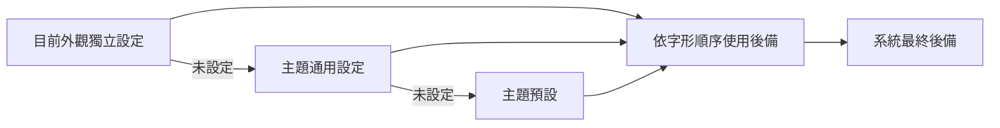

# 主題字體



用預覽底部滑桿按鈕或 Cmd+, 開啟「設定」，再進入「字體」。
「字體」面板可選擇主題通用、淺色、深色，列出完整名稱、可用狀態與實際 Core Text
字形來源，按「套用」才儲存。重設淺色／深色恢復繼承主題設定；重設通用設定恢復
預設，但保留獨立淺深色設定。System 模式暫時略過自訂字體，不刪除設定。
操作控制項使用系統無襯線，技術上下文使用系統等寬。不會下載或安裝字體。

| 主題           | 首選字體                  | 有序後備                                                  |
| -------------- | ------------------------- | --------------------------------------------------------- |
| Paper Punch    | `Impact`                  | `AvenirNextCondensed-Heavy`、`@system-condensed`          |
| Dot Instrument | `DotoMod800ZhRefined`     | `Doto`、`DeparturePixelZhCompact-Regular`、`@system-mono` |
| Swiss Signal   | `HelveticaNeue-Bold`      | `@system`                                                 |
| Hard Edge      | `BlackOpsOne-Regular`     | `Impact`, `@system-condensed`                             |
| Blueprint      | `SairaStencilOne-Regular` | `DeparturePixelZhCompact-Regular`, `@system-condensed`    |

Impact、Avenir、Helvetica 來自 Mac 現有系統安裝，不隨 Grant 分發。個人 Doto
Refined 由 X-FontMod 產生，可選但未打包。Higher 是窄版 Tall Condensed 的
HGHT=128 命名實例（寬度85%，Doto700 烘焙為 regular
中繼資料），可自行加入字體順序。 不合成粗體、不額外變形。隨附 Doto 明確選用
wght=800、ROND=0；Compact 直接讀取 已驗證來源產物。來源、雜湊及完整授權見
Resources/Licenses/fonts.json。AI 字形不證明 實際字體身分。

缺少字體會略過；缺少某個字形會逐個組合字元嘗試後續字體。Dot 優先使用 Refined
中文，其次使用隨附 Compact；Blueprint 的中文使用隨附 Compact，
Paper／Swiss／Hard Edge 保留平台中文後備。所有設定都有系統
最終後備，含中文、符號與 Emoji；整個順序缺少仍可讀。系統標記僅支援 @system、
@system-condensed、@system-mono。

Black Ops One 與 Saira Stencil One 從隨附 TTF 檔案直接載入，固定版本的官方來源、
SHA-256 與原始 OFL 授權記在字體清單。Blueprint 依實際字形邊界適配與置中， 避免
Saira 較大的行高留白縮小標題；字體檔案、輪廓與寬度均不修改。

## 設定

兩個 override 物件均為 schema1 可選擴充。每個順序1–12個非空 PostScript 名稱，
每個最多128字元。路徑、控制字元、未知 @ 標記及無效外觀名稱會被拒絕；不存在的
字體名稱可儲存並明確提示。System
外觀依實際淺深色選擇對應字體。範例使用可選本機字體：

```json
{
  "schemaVersion": 1,
  "style": "dot",
  "appearance": "system",
  "typography": "theme",
  "language": "en",
  "fontOverrides": {
    "dot": [
      "DotoMod800ZhRefined",
      "Doto",
      "DeparturePixelZhCompact-Regular",
      "@system-mono"
    ]
  },
  "appearanceFontOverrides": {
    "dot": {
      "light": [
        "DotoMod800ZhRefined",
        "Doto",
        "DeparturePixelZhCompact-Regular"
      ],
      "dark": [
        "DotoMod700ZhRefinedTallCondensed-Higher",
        "Doto",
        "DeparturePixelZhCompact-Regular"
      ]
    }
  }
}
```

預覽 JSON 原子儲存後解碼讀回。舊檔案先逐位元組備份為
settings.before-selected-themes.json，再將 module 遷移為 dot、nothing 為 paper、
舊 typography dots 為 theme，保留字體設定。無效輸入不覆蓋已儲存偏好。
已安裝設定 App 與 CLI 共用外觀設定，開發預覽使用隔離狀態目錄。改變字體
不會啟用外掛或改變授權規則。SecurityAgent 的可用字體可能不同，真實宿主載入
需要獨立授權測試。

`./grant render` 檢查單行標題／上下文、缺少字體與系統最終後備、淺深色獨立字形
來源、繼承與無效外觀設定拒絕；同時審閱真實原生截圖。
